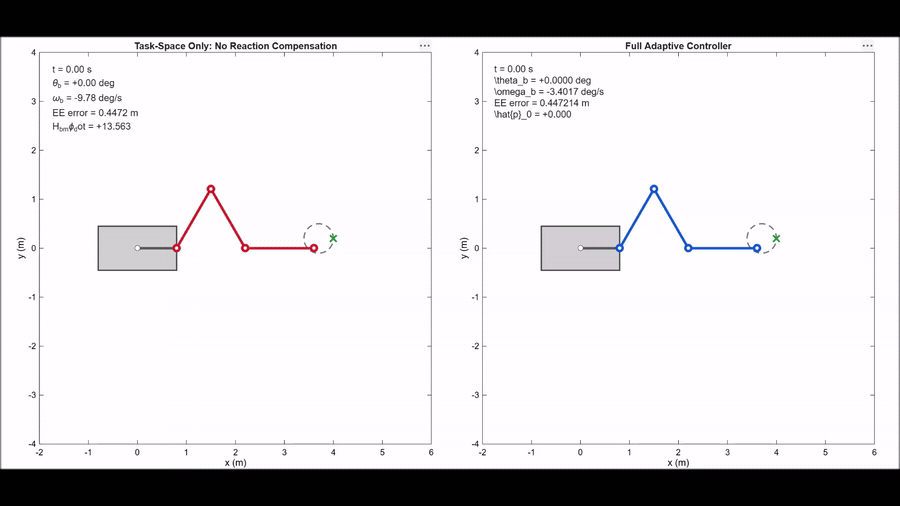
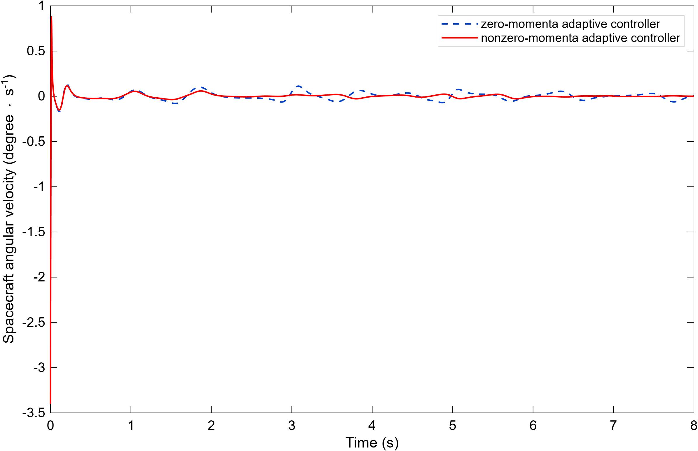
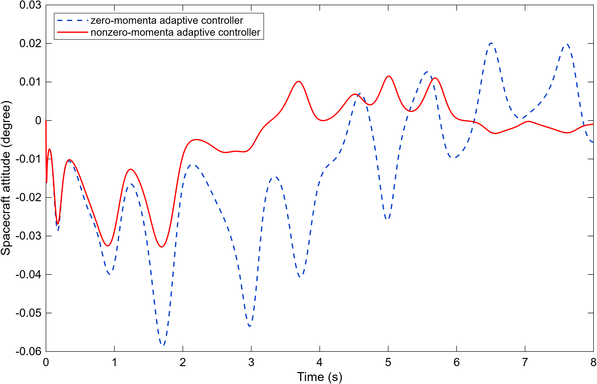
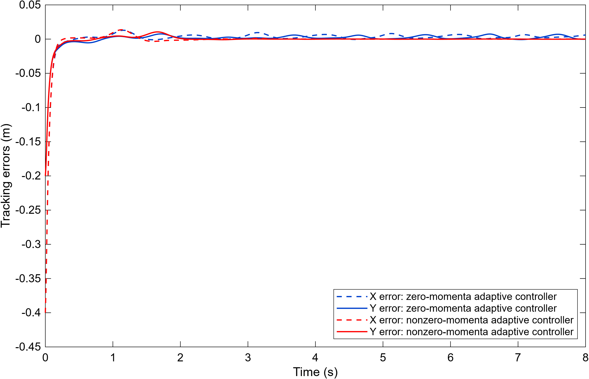
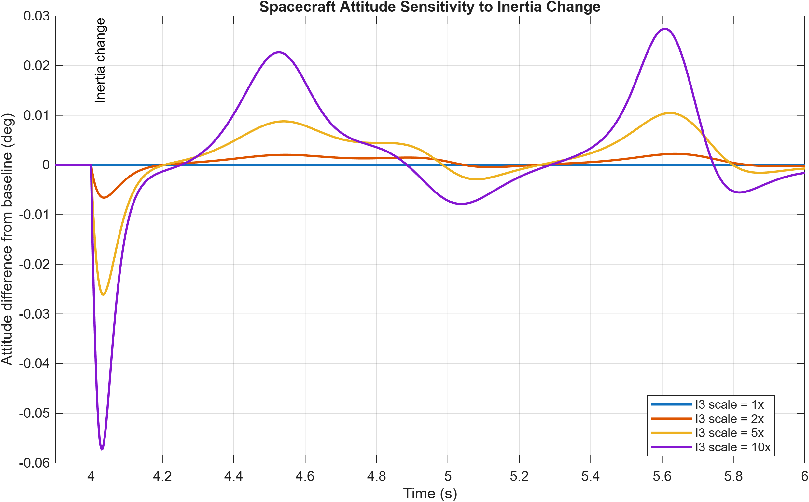
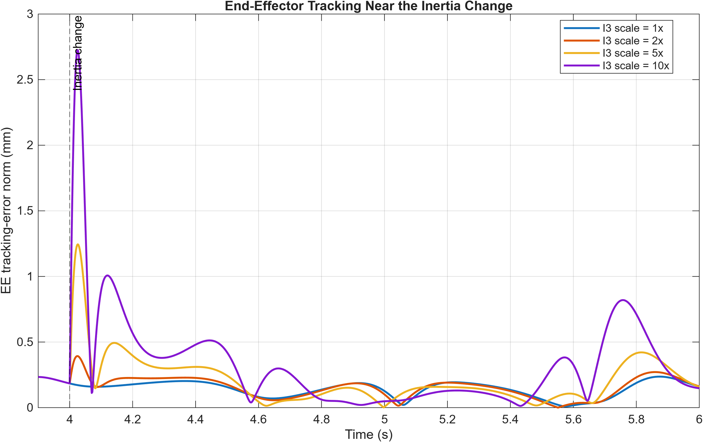
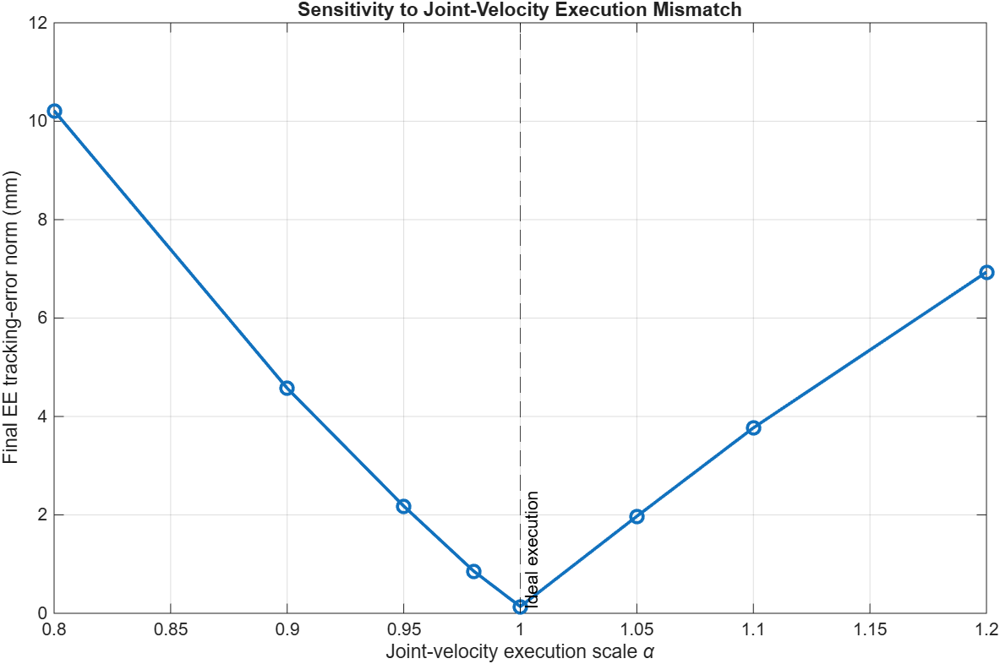

# Adaptive Zero-Reaction Motion Control for Free-Floating Space Manipulators

<p align="center">
  
</p>

<p align="center">
  <em>Left: illustrative task-space-only controller without spacecraft-reaction compensation. Right: the full adaptive controller, regulating spacecraft attitude while tracking the end-effector trajectory.</em>
</p>

## Overview

This repository provides a **MATLAB reproduction and numerical evaluation** of the adaptive reaction-null-space (RNS) controller proposed by Xu *et al.* (2016) for a **planar, three-revolute-joint (3R) free-floating space manipulator**.

The controller combines:

- **Spacecraft attitude regulation** during manipulator motion.
- **Cartesian end-effector trajectory tracking**.
- **Online estimation of unknown dynamic and kinematic parameters**.
- **Compensation for nonzero initial angular and linear momentum**.

The project reconstructs the published model's parameters, reproduces **Xu's Figs. 2–9**, validates key numerical identities, investigates differences from the published plots, and tests sensitivity to simplified changes in inertia and joint-velocity execution.

> **Animation note:** The left-hand controller is an *illustrative task-space-only baseline*, **not** the zero-momenta adaptive controller from Xu's paper. The published zero- versus nonzero-momenta controller comparisons are generated separately in the reproduction plots.

## Quick start

**Requirements:** MATLAB (tested with **MATLAB R2026a**). Open MATLAB with its **Current Folder** set to the **repository root** — the directory containing `config/`, `simulation/`, and `plots/`.

### 1. Reproduce the figures

```matlab
addpath(genpath(pwd));
run('plots/reproduce_figures.m');
```

This runs the **full nonzero-momenta adaptive controller** and the **zero-momenta adaptive comparison** with the same nonzero-momentum physical plant. It generates the eight reproduced plots in `results/figures/`.

### 2. Run the adaptive simulation directly

```matlab
addpath(genpath(pwd));
cfg = paper_params();
sim = simulate_plant(cfg);

% Example output metrics
final_attitude_deg = rad2deg(sim.theta_b(end));
final_ee_error_mm = 1000 * norm(sim.delta_x(end, :));
```

### 3. Generate the MATLAB animations

```matlab
run('visualization/animate_full_adaptive_controller.m');
run('visualization/animate_reaction_null_space.m');
```

The first animation compares the full adaptive controller with an illustrative task-space-only baseline; the second visualizes reaction-null-space motion. Existing recordings are stored in `results/animations/`.

## Reproduction results

<p align="center">
  
  
</p>
<p align="center"><em>Spacecraft angular velocity (Xu Fig. 2) and spacecraft attitude (Xu Fig. 3).</em></p>

<p align="center">
  
</p>
<p align="center"><em>Cartesian end-effector tracking errors (Xu Fig. 4).</em></p>

Using Xu's published attitude-feedback gain **λ<sub>b</sub> = 60**, a **2 ms** simulation timestep, and explicit forward-Euler integration:

| Numerical result | Value |
| --- | ---: |
| Final spacecraft attitude | −0.000980° |
| Final end-effector tracking-error norm | 0.13655 mm |
| Reconstructed initial angular momentum | −1.64672508 kg·m²/s |
| Maximum angular-momentum constraint residual | 4.44 × 10⁻¹⁶ kg·m²/s |

### Differences from Xu's published figures

The main attitude-regulation and end-effector-tracking behaviors are reproduced, but our spacecraft **attitude and angular-velocity transients differ in amplitude** from the published curves. A numerical gain-scaling experiment found that **doubling the effective attitude-feedback gain** improves the match to approximate traces extracted from the original figures. The primary reproduction **retains Xu's published gain** rather than tuning it to match; the reason for the difference is unresolved.

The other reproduced plots — dynamic parameter estimates, initial angular-momentum estimate, kinematic estimates, center-of-mass velocity estimate, and estimated base inertia — are in `results/figures/`.

## Verification and tests

Run from the **repository root**, after adding the project path:

```matlab
addpath(genpath(pwd));

% Reaction-null space, kinematics, and momentum
run('tests/test_rns.m');
run('tests/test_kinematics.m');
run('tests/test_momentum.m');

% Reconstruct 10 dynamic coefficients from the physical inertia model
% and verify them on independent configurations
test_dynamic_coefficients();

% Known-parameter, attitude-only, and full adaptive controllers
run('tests/test_known_controller.m');
run('tests/test_attitude_controller.m');
run('tests/test_adaptive_controller.m');
```

The dynamic-coefficient test performs **numerical identification** using an already specified regressor basis; it is not a symbolic derivation of the regressor structure.

Additional numerical and discrepancy checks:

```matlab
run('validation_and_sensitivity_tests/convergence_study.m');
run('validation_and_sensitivity_tests/momentum_conservation_check.m');
run('discrepancy_analysis/discrepancy_checks.m');
run('discrepancy_analysis/feedback_gain_sweep.m');
```

The published-curve comparisons use the included `actual_fig2.png` and `actual_fig3.png`, which are raster images, so their digitized curve values are approximate.

## Sensitivity experiments

<p align="center">
  
  
</p>
<p align="center"><em>Attitude and Cartesian tracking sensitivity to a sudden terminal-link inertia change at t = 4 s.</em></p>

```matlab
run('validation_and_sensitivity_tests/test_payload_capture.m');
run('validation_and_sensitivity_tests/test_velocity_servo_mismatch.m');
run('validation_and_sensitivity_tests/check_inertia_timestep_convergence.m');
```

<p align="center">
  
</p>

- **Inertia perturbation:** Scales the last link's rotational inertia at **t = 4 s** while holding its mass and center of mass unchanged. It is a *simplified disturbance test*, **not** a physically consistent capture model.
- **Velocity execution mismatch:** Applies `actual joint velocity = α × commanded joint velocity` to evaluate sensitivity to the ideal velocity-servo assumption. This is **not** a full actuator dynamics model.

## Repository structure

```text
adaptation/                        Regressors and online parameter updates
config/                            Physical parameters, gains, initial conditions
controllers/                       Adaptive and known-parameter controllers
discrepancy_analysis/              Published-curve analysis and gain tests
model/                             Geometry, Jacobians, momentum and inertia
plots/                             Figure reproduction and comparison plots
results/
  animations/                      Animated GIF preview and simulation videos
  figures/                         Reproductions of Xu's Figs. 2–9
  inertia_perturbation/            Sensitivity plots and numerical summaries
rns/                               Reaction-null-space operations
simulation/                        Full and zero-momenta simulation pipelines
tests/                             Model and controller verification
trajectories/                      Desired end-effector trajectory
validation_and_sensitivity_tests/  Timestep and disturbance studies
visualization/                     MATLAB animation scripts
actual_fig2.png                    Xu's published angular-velocity figure
actual_fig3.png                    Xu's published attitude figure
```

## Assumptions and limitations

- The system is **planar** and **free-floating**; the main control law commands joint velocities, not torques.
- The original model assumes **constant physical parameters**, no external forces or torques, and a fast lower-level controller that tracks joint-velocity commands ideally.
- Angular momentum conservation is **enforced algebraically** by the plant. Its near-zero residual demonstrates internal consistency, not an independent validation of torque-level dynamics.
- Explicit forward Euler is used with a nominal **2 ms** step; convergence checks explore smaller steps.
- The published plots were compared using approximately digitized raster images, not original numerical simulation data.
- The inertia-change and velocity-mismatch tests are exploratory, **not** physically complete simulations of contact, payload capture, or actuator dynamics.

## Citation

> S. Xu, H. Wang, D. Zhang, and B. Yang, “Adaptive zero reaction motion control for free-floating space manipulators,” *IEEE Transactions on Aerospace and Electronic Systems*, vol. 52, no. 3, pp. 1067–1076, 2016. DOI: [10.1109/TAES.2016.130715](https://doi.org/10.1109/TAES.2016.130715).

**Independent MATLAB reproduction and numerical evaluation by Aman Sunesh, New York University Abu Dhabi.**
